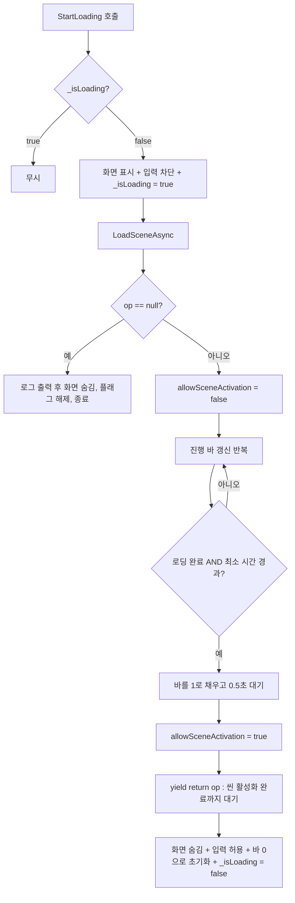

# 로딩 UI 구현 정리

> 씬 이동 시 로딩 화면을 띄우는 기능의 구조와 구현 과정을 정리한 문서이다.

---

## 1. 개요

- 씬을 이동할 때 진행 바가 있는 로딩 화면을 띄운다.
- 별도의 LoadingScene을 만들지 않고, **씬 위에 덮이는 UI 오버레이 방식**으로 구현했다.

### UI 오버레이 방식을 고른 이유

| 기준 | 로딩씬 방식 | UI 오버레이 방식 (채택) |
|---|---|---|
| Additive 전투(스테이지) 대응 | 불가. 스테이지 씬이 언로드되어 노드 진행이 사라짐 | 가능. 같은 방식으로 감쌀 수 있음 |
| 구조 | 로딩씬 추가, Build Settings 등록, 다음 씬 이름을 static으로 전달 | 매니저 하나와 캔버스 하나 |
| 장점이 필요한가 | 이전 씬을 메모리에서 완전히 내리는 장점은 현재 씬 규모에서 의미가 작음 | 전환 연출만 있으면 충분함 |

---

## 2. 구성 요소

### 2.1 오브젝트 구조 (TitleScene)

```
LoadingManager            ← LoadingManager.cs, DontDestroyOnLoad
└─ LoadingCanvas          ← 프리팹 인스턴스 (Assets/Prefabs/UI/LoadingCanvas.prefab)
   ├─ BackGround          ← 화면 전체를 덮는 배경
   ├─ LoadingBar          ← 회색 바 바탕
   ├─ LoadingFillBar      ← 초록 바 (Image Type: Filled / Horizontal)
   └─ Text (TMP)          ← "로딩 중..." (DoHyeon 폰트)
```

- **LoadingManager는 TitleScene에만 배치한다.** 부모에서 `DontDestroyOnLoad`를 호출하므로 자식인 캔버스도 함께 유지된다.
- LoadingCanvas 설정
  - Canvas: Screen Space - Overlay, Sort Order 999. 씬마다 카메라가 달라도 항상 맨 위에 그려진다.
  - CanvasGroup: 시작 값은 alpha 0, Blocks Raycasts false. 평소에는 보이지 않고 클릭도 막지 않는다.

### 2.2 LoadingManager.cs

`Assets/Scripts/Manager/LoadingManager/LoadingManager.cs`

| 멤버 | 역할 |
|---|---|
| `Instance` | 싱글톤 접근점 |
| `_canvasGroup` | 로딩 화면 표시/숨김(alpha), 입력 차단(blocksRaycasts) |
| `_loadingFillBar` | 진행 바 Image (`fillAmount`) |
| `_minLoadingTime` | 최소 표시 시간. Inspector 값을 사용한다 (현재 1초) |
| `_isLoading` | 로딩 중 중복 실행 방지 플래그 |
| `StartLoading(string)` | 외부에서 호출하는 진입점 |
| `LoadingDelay(string)` | 실제 로딩을 처리하는 코루틴 |

### 2.3 역할 분리

| 클래스 | 역할 |
|---|---|
| `SceneChanger` / `TitleSceneChanger` | 버튼과 연결된 창구. **어느 씬으로 갈지** 정한다 |
| `LoadingManager` | **어떻게 갈지** 처리한다. 비동기 로드와 로딩 UI를 담당 |

호출 방향은 **SceneChanger → LoadingManager** 한쪽뿐이다. LoadingManager는 SceneChanger를 참조하지 않는다.

SceneChanger를 중간에 두는 이유는 다음과 같다.
1. LoadingManager는 TitleScene에서 넘어온 `DontDestroyOnLoad` 오브젝트라서, 다른 씬 버튼의 OnClick에 Inspector로 직접 연결할 수 없다.
2. 기존 버튼들이 이미 `SceneChanger.SceneChange("씬이름")`에 연결되어 있어서, 내부만 바꾸면 버튼 설정을 손대지 않아도 된다.

---

## 3. 로딩 흐름



### 핵심 포인트

1. **`allowSceneActivation = false`**
   - 로딩이 끝나도 씬이 바로 넘어가지 않고 대기한다.
   - 이 상태에서 `op.progress`는 **0.9에서 멈춘다.** 그래서 0.9를 로딩 완료로 본다.
2. **진행 바 계산**
   - 로딩 비율 = `op.progress / 0.9f`
   - 시간 비율 = `elapsedTime / _minLoadingTime`
   - 바 값 = `Mathf.Min(로딩 비율, 시간 비율)`
     - 로딩이 빠르면 최소 시간 동안 부드럽게 찬다.
     - 로딩이 느리면 바가 실제 로딩보다 앞서 나가지 않는다.
3. **반복 조건은 `||`**
   - `op.progress < 0.9f || elapsedTime < _minLoadingTime`
   - 둘 다 끝나야 빠져나간다. `&&`를 쓰면 최소 시간이 무시된다.
4. **`yield return op`**
   - 씬 활성화가 끝날 때(`isDone`)까지 기다린다.
   - `yield return null`(1프레임 대기)로는 씬이 다 뜨기 전에 로딩 화면이 꺼질 수 있다.
5. **unscaled time 사용**
   - `Time.unscaledDeltaTime`, `WaitForSecondsRealtime`을 사용한다. `timeScale = 0` 상태에서도 로딩이 멈추지 않는다.
6. **null 체크에서 상태 되돌리기**
   - 씬 이름이 틀리거나 Build Settings에 없으면 `LoadSceneAsync`가 null을 반환한다.
   - `yield break` 전에 alpha, blocksRaycasts, `_isLoading`을 되돌리지 않으면 로딩 화면에 갇힌다.

---

## 4. 호출부 적용 현황

모든 호출부는 아래와 같은 형태로 통일했다.

```
if (LoadingManager.Instance != null)  → LoadingManager.Instance.StartLoading(씬이름)
else                                  → SceneManager.LoadScene(씬이름)
```

`else`는 MainScene 등에서 바로 Play했을 때(LoadingManager가 없을 때)를 위한 안전장치다.

| 위치 | 경로 | 적용 |
|---|---|---|
| `TitleSceneChanger.GameStart()` | Title → Main (첫 실행) | ✅ |
| `GameManager.ResetGame()` | Title → Main (GameManager가 이미 있을 때) | ✅ |
| `SceneChanger.SceneChange(string)` | 메인 ↔ 트레이닝, 성장 던전, 스테이지 선택 등 | ✅ |
| `SceneChanger.EnterBattle()` | 성장 던전 → BattleScene. 내부에서 `SceneChange("BattleScene")` 재사용 | ✅ |
| `GameManager.DateCheck()` | 게임오버 시 MainScene | ❌ 의도적으로 제외 |
| `StageSceneChanger.LoadBattleScene()` | 스테이지 → BattleScene (Additive) | ❌ 의도적으로 제외 |
| `SceneChanger.CloseBattleScene()` | BattleScene 언로드 (Additive) | ❌ 의도적으로 제외 |

### 제외한 이유

- **DateCheck**: 로드 직후 `Time.timeScale = 0`을 설정한다. 비동기로 바꾸면 씬 전환보다 timeScale 변경이 먼저 적용되어 게임오버 처리 시점이 달라진다.
- **Additive 전투**: 스테이지 씬을 유지한 채 BattleScene을 얹는 구조다. Single 로드로 바꾸면 스테이지 진행이 사라진다.

---

## 5. 구현 과정에서 겪은 문제와 해결

| 문제 | 원인 | 해결 |
|---|---|---|
| 로딩 캔버스가 화면에 나오지 않음 | 매니저가 씬 인스턴스가 아니라 **프리팹 에셋**을 참조함 | 프리팹을 씬에 배치하고 매니저 오브젝트의 자식으로 둠 |
| 싱글톤 중복 판정이 의도와 다름 | `Instance.gameObject != this` (GameObject와 Component 비교) | `Instance != this`로 수정 |
| 한 번 로딩하면 다음부터 동작 안 함 | `gameObject.SetActive(false)`로 매니저 자체를 꺼서 코루틴 실행 불가 | SetActive 대신 CanvasGroup alpha와 blocksRaycasts 사용 |
| 존재하지 않는 씬 로드 에러 | `LoadSceneAsync("_sceneChanger")`처럼 변수명을 문자열로 넘김 | `StartLoading(string sceneName)` 인자로 받아 전달 |
| 씬이 두 번 로드됨 | 기존 `LoadScene` 줄 아래에 `StartLoading`을 **추가**함 (`else` 누락) | if/else로 둘 중 하나만 실행되게 수정 |
| 로딩 화면 없이 씬이 넘어감 | `ResetGame`에서 `SceneManager.LoadSceneAsync`를 직접 호출 | `LoadingManager.Instance.StartLoading`으로 교체 |
| `[SerializeField]`로 매니저를 참조하면 끊김 | 씬 재진입 시 새 매니저가 Destroy되면서 참조가 사라짐 | `LoadingManager.Instance`로 접근 |
| 씬이 아예 넘어가지 않음 | `allowSceneActivation = false` 후 true로 되돌리지 않음 | 반복문 후 true로 설정 |
| 이전 씬이 잠깐 보임 | 전환 허용 직후 바로 화면을 숨김 | `yield return op`로 활성화 완료까지 대기 |
| 바가 끝까지 안 참 | `fillAmount`에 `op.progress`(최대 0.9)를 그대로 넣음 | `op.progress / 0.9f` |
| 최소 표시 시간이 무시됨 | 반복 조건에 `op.isDone`을 사용 (대기 중에는 항상 false) | `elapsedTime < _minLoadingTime`으로 교체 |
| 다음 로딩 때 바가 꽉 찬 채 시작 | 종료 시 바를 1로 남겨 둠 | 종료 시 `fillAmount = 0` |

### 로딩과 무관했던 문제: 전투 진입 시 캐릭터가 idle이 아닌 자세로 보임

- **원인**: `Assets/Animator/AnimationsController.controller`의 기본 상태가 모션이 없는 `New State`였다. IdleA로 넘어가기 전까지(Exit Time 0.75 + Transition 0.25) 약 1초 동안 기본 자세가 보였다.
- 로딩 화면이 씬 활성화 직후에 꺼지기 때문에 로딩 문제처럼 보였을 뿐, 이 현상은 로딩 기능을 넣기 전에도 있었다.
- **해결**: Animator 창에서 IdleA를 **Set as Layer Default State**로 지정했다.
- 몬스터에 같은 현상이 보이면 해당 Animator Controller도 같은 방식으로 확인한다.

---

## 6. 사용 방법

- **새 씬 이동 버튼 추가**: 버튼 OnClick에 해당 씬의 `SceneChanger.SceneChange`를 연결하고 씬 이름을 입력한다. 로딩 화면은 자동으로 적용된다.
- **코드에서 씬 이동**: `SceneManager.LoadScene` 대신 4장의 if/else 형태를 사용하거나, 가능하면 `SceneChanger.SceneChange`를 거친다.
- **최소 표시 시간 조절**: TitleScene의 `LoadingManager` Inspector에서 `Min Loading Time` 값을 바꾼다. 씬에 저장된 값이 코드 기본값보다 우선한다.
- **새 씬 추가 시**: Build Settings에 등록해야 한다. 등록하지 않으면 `LoadSceneAsync`가 null을 반환하고 로딩이 취소된다.

---

## 7. 테스트 체크리스트

- [ ] Title → Main (게임 시작)
- [ ] Main → 트레이닝 → Main
- [ ] Main → 성장 던전 → 전투 입장 → 승리 또는 패배 → Main
- [ ] Main → 스테이지 선택 → Stage1 → Main
- [ ] 각 이동에서 로딩 화면이 표시되고, 연타해도 한 번만 이동함
- [ ] 로딩 중 뒤쪽 버튼이 눌리지 않음
- [ ] 두 번째 이동부터도 바가 빈 상태에서 시작함
- [ ] 씬 이름을 틀리게 넣으면 로그가 출력되고 원래 씬에 남으며, 이후 다른 이동은 정상 동작함
- [ ] MainScene에서 바로 Play해도 에러 없이 이동함 (로딩 화면 없이)
- [ ] Console에 에러 없음

---

## 8. 남은 작업 (선택)

- `LoadingDelay`의 null 체크 로그를 `Debug.LogError`로 바꾸고 실패한 씬 이름을 함께 출력한다.
- 스테이지 Additive 전투 진입/종료에도 로딩 연출을 적용한다. 이 경우 `_allObject.SetActive(false)`가 로딩 화면이 덮인 뒤에 실행되도록 순서를 맞춰야 한다.
- 페이드 인/아웃 연출 (CanvasGroup alpha 보간)
