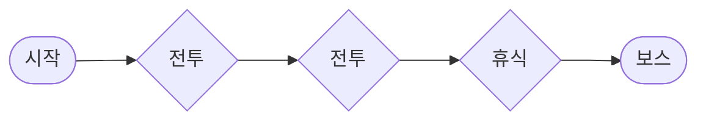

# Unity 6 3D 싱글 육성 턴제 게임 개발 명세서
## 프로젝트 목표
Unity 6을 사용하여 3D 싱글 육성 턴제 게임을 개발한다.
성장 던전에서 재료들을 모아서 스킬을 습득하고 스탯을 강화한다.

### 개발 환경
- 엔진: Unity6 6000.3.9f1 LTS
- 언어: C#
- 게임 형태: 3D 싱글 육성 턴제 게임
- 개발 기간: 2026.11.06 ~ 2026.11.24
- 플랫폼: Windows 

### 주요 플레이 목표
- 게임 목표 100일의 시간동안 4개의 스테이지를 빠르게 모두 클리어를 하는 것을 목표로 한다.

### 게임 시스템
- 100일의 시간동안 플레이어를 육성해 스탯을 올라거나 스킬을 습득한다.
- 100일이 초과하면 게임이 끝나고 게임오버 패널이 나온다.
 - 모은 성장재화는 스킬을 습득하거나 스탯 강화에 사용된다.
 - 던전은 단일 전투로 진행되면 난이도는 총 3개로 구성되어 있다.
- 던전이나 스테이지에서 감소한 hp,mp는 던전이나 스테이지 클리어 하더라도 그대로 유지된다.
 - 감소한 hp,mp 회복을 MainScene 에서 잠자기로 Max까지 회복한다. 잠자기를 하면 1일이 차감된다.  
- 스테이지 총4개가 존재하고 각 스테이지 마다 배틀칸과 보스칸, 휴식 칸이 있으며 단일 전투를 기본으로 하며 휴식칸에서는 hp,mp가 30% 회복이 디며 스킬 구성을 변경이 가능하다. 보스칸을 클리어시 BossClearPanel을 띄우고 스테이지 나가기 버튼을 누를 시 MainScene로 이동되고 스테이지가 클리어 된것으로 간주 게임매니저에게 체크 이벤트롤 보내며 스테이지 클리어 체카 되고 클리어한 스테이지는 재입장이 불가능하다.
- 스테이지는 처음에 스테이지1 만 입장이 가능하며 스테이지1 클리어시 스테이지2가 활성화 된다 순차적 해금.
- 스테이지 입장 차감 일수는 없다.
- 플레이어 BattleScene에서는 공격 지시 칸이 3개 존재하면 한칸은 기본 공격으로 고정한다. 나머지 2칸은 SkillSettingPanel에서 스킬을 습득해 장착 할수가 있다. 기본적으로 시작시 스킬 칸은 비어 있는 상태로 비활성화 되며 스킬을 장착해야 활성화가 된다. 스킬마다 소모 Mp가 다르며 보유 mp보다 소모량이 크면 스킬 발동이 불가능하다.
- 스킬은 현재 2가지를 구현한다 단일 공격과 전체 공격을 구현한다. 기본 공격은 mp사용량이 없다.
- 턴 방식으로 진행이 되며 속도가 빠른 존재부터 선공이 가능하며 순서는 큐 알고리즘으로 구성한다. 만약 속도가 같을 시 플레이어 우선 공격.
- trainingScene에서는 플레이어의 스텟을 각각 강화한다.

(스테이지1 씬 구성 예시) 이런 구성으로 총 4개의 스테이지1-4 씬이 존재한다.

## 게임매니저 
- 게임 매니저는 게임 진행상황을 관리한다.
- 경과일수 체크와 감소를 관리하며 100일 초과되어 남은 일수가 0 이하가되면 게임오버패널을 띄운다.
- 100일 안에 스티이지 4개 클리어시 GameClearPanel을 띄운다
- 스테이지 클리어 여부를 관리한다.
-재화 관리하며 재화를 얻거나 사용하면 합 차감을 한다.

## 턴매니저 
- 턴 매니저는 BattleScene에서 턴을 관리하며 배틀칸 보스칸 ,던전 모두 같은 BattleScene을 이용한다. 
- 턴 매니저는 플레이어 턴인지 몬스터 턴인지 확인하며 배틀 시작과 끝도 관리한다.
- 재화 던전에서는 ResultPanel을 띄우고 얻은 재화 결과를 보여주고 재도전과 나가기 버튼을 보여준다
- 전투 승리시 WinPanel을 띄우고 진행하기 버튼을 띄운다
- 플레이어 hp가 0이하로 떨어지면 전투 패배시 losePanel을 띄우고 나가기 버튼을 보여준다. 나가기 버튼은 MainScene로 이동된다.
- 플레이어가 스킬이나 기본 공격 칸을 눌러 공격시 자동으로 플레이어 턴이 끝난다.

## 배틀메니저  
- 배틀칸 보스칸 ,던전 모두 같은 BattleScene을 이용한다. 던전은 난이도 칸 스테이지는 배틀칸, 보스칸 각 칸이 가진 몬스터 위치와 종류 정보를 받아 적용한다.
- 플레이어와 몬스터(적)의 체력을 관리하고 적을 모두 쓰러트리면 WinPanel을 플레이어 hp가 0이 되면 LosePanel을 띄우게 턴매니저 에게 알린다.

## 패널과 씬
- GameStartScene: 개임 처음 시작시 보이는 씬
 - 게임시작,이어하기, 게임 종료 버튼이 존재한다(이어하기는 나중에 저장,로드 기능은 게임진행이 정상적으로 되면 추후 구현해서 연결한다.)

- MainScene: 플레이어 스텟과 hp,mp를 보여주고 trainingScene이동 버튼, 스테이지 씬 이동 버튼과 성장 던전 씬 이동 버튼이 존재하며 SkillSetingPanel 패널 활성화 버튼이 존재. 잠자기 패널 활성화 버튼, 설정 패널 버튼도 있다.

- trainingScene: 스텟을 보여주며 각 스탯을 선택시 강화 버튼이 활성화 되며 소모량과 강화후 스텟 수치를 보여준다 재화 소모로 스탯을 강화는 곳

- SkillSettingPanel: 재화를 소모하여 스킬을 습득하거나 습득한 스킬을 스킬칸에 탈부착 가능하게 한다.

- 회복칸 Panel: 회복 버튼(hp.mp 30% 회복)과 스킬 세팅 버튼(SkillSettingPanel 활성화), 회복 종료 버튼(회복칸 Panel 끈다)이 존재

- 잠자기 패널: 회복하기와 나가기 버튼이 있으며 회복 버튼 누르시 잠을자면 100%체력과 마나가 회복 되지만 1일이 감소합니다. 라는 패널을 띄운다 이 패널을 예와 아니오로 구분한다. 예를 누르시 1일 차감한다.

- BattleScene: 순서와 현재 hp,mp 수치와 바를 보여주며,설정버튼이 존재. 행동 선택 기본 공격 칸과 스킬칸 2개 총 3칸이 존재하며, 몬스터 타깃 설정은 마우스 우클릭으로 하며 몬스터 타깃 후 행동 기본 공격이나 스킬 칸을 우클릭 선택해야 행동을 한다.

- 성장 던전 씬: 난이도 선택 칸이 3개 있으며 게임 시작부터 모두 활성화 되어있다. 난이도 칸 클릭시 입장하시겠습니까? 패널이 나오며 예,아니오 버튼이 존재한다 예를 누를시 BattleScene으로 이동하며 1일 차감 전투 패배시 losePanel나오고 나가기 버튼만이 존재 누르면 추가로 2일이 차감되고 hp,mp 최대로 회복한다.(총 3일) 클리어시 차감은 없다.

- 스테이지 씬: 스티이지는 총 4개 칸이 순차 해금으로 진행한다. 있으며 스테이지 누를시 입장하시겠습니까? 패널이 나오며 예,아니오 버튼이 존재한다. 스테이지1 씬으로 이동하며, 배틀칸, 회복칸 보스 칸이 단 방향 간선으로 이어져 있으며 순차 대로 해야 다음 노드로 이동이 가능하다. 배틀칸으로 갈시 BattleScene으로 이동하며 패배시 losePanel 3일 차감 보스 클리어시 일수 차감은 없다. 중도 포기면 3일이 차감된다. hp,mp는 최대치 까지 회복.

- losePanel: 나가기 버튼 만 있으며 누를시 던전인지 스테이지 인지에 따라 맞는 일수를 차감한다.

- PausePanel: BattleScene에서의 설정을 누르시 게임이 timescale = 0되어 일시정지되고 포기하기와 이어하기 버튼이 존재하며 이어하기는 timescale= 1이 되어 게임이 다시 진행되고 포기하기를 누르면 timescale= 1이되고 MainScene로 이동되며 던전에서는 2일 스테이지에서는 3일이 차감되고 hp,mp 완전히 회복 된다.

## 플레이어(Player)
### 스텟
- 체력(float), 마나(int), 공격력(float), 방어력(float), 스피드(int)

#### 체력(hp)
- 체력은 0 아래로 내려가지 않는다.
- 체력이 0이하가 되면 TurnManager가 losePanel이 나오게 한다.

#### 마나(mp)
- 마나는 0 이하로 내려가지 않는다.
- 스킬 사용시 마나를 소모한다.
- 소모량 보다 마나가 적으면 스킬을 사용할 수 없다.

#### 공격력(attackvalue)
- 데미지 = 스킬 퍼센트 * 공격력 로 계산하다.(소수점 버림)
- 기본 공격 데미지는 공격력으로 한다.

#### 방어력(defend)
- 감소율 = 방어력 * 0.001f (방어력이 100이면 0.1f로 계산)
- 받는 데미지 = Max(데미지 * (1 - 감소율), 0) (소수점 버림)
- 받는 데미지는 0 이하로 감소하지 않는다.

#### 스피드(speed)
- 몬스터 보다 빠를수록 선턴(선공)을 잡는다.